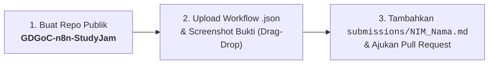

<p align="center">
  <h1 align="center">GDG on Campus Universitas Widyatama</h1>
  <h3 align="center">n8n AI & Automation Study Jam — Submission Directory</h3>
  <p align="center">
    
    
    
    <a href="https://github.com/xdyaksa/Submission-n8n-AI/pulls"></a>
  </p>
</p>

> [!NOTE]
> **Pusat Pengumpulan Tugas & Showcase Portofolio**: Repositori ini merupakan direktori pusat pengumpulan tugas peserta **n8n AI & Automation Study Jam** Google Developer Groups on Campus (GDGoC) Universitas Widyatama. Pengumpulan dilakukan secara kolaboratif melalui mekanisme Pull Request ramah pemula yang dapat diselesaikan **100% via Web Browser tanpa terminal**.

---

## 📖 Tentang Repositori Ini

Selamat datang di **Portal Pengumpulan Tugas n8n Study Jam GDGoC Universitas Widyatama**!

Repositori ini berfungsi sebagai wadah sentral kurasi, peninjauan kode alur kerja (*workflow review*), serta etalase portofolio bersama bagi seluruh peserta Study Jam. Melalui repositori ini, peserta mendokumentasikan pencapaian materi dari Pertemuan 1 hingga Pertemuan 5 (Capstone Project), mencakup:
- Alur kerja otomasi dasar & integrasi node n8n (P1)
- Trigger Webhook & manipulasi struktur data JSON (P2)
- Integrasi RESTful API eksternal & penanganan error (P3)
- Pemanfaatan AI Agent, LLM Chain, dan Memory di n8n (P4)
- Proyek akhir otomasi mandiri berbasis kecerdasan buatan (P5)

---

## 🗂️ Struktur Folder Utama

Repositori ini disusun secara terstruktur untuk memudahkan navigasi peserta dan tim verifikator:

```text
Submission-n8n-AI/
├── .github/
│   ├── PULL_REQUEST_TEMPLATE.md   # Formulir otomatis saat peserta membuka Pull Request
│   ├── workflows/                 # Otomasi sinkronisasi daftar kontributor otomatis
│   └── scripts/                   # Skrip Python pemroses data submission peserta
├── doc/
│   └── SUBMISSION_GUIDE.md        # Panduan teknis lengkap pengumpulan 100% via browser
├── submissions/                   # Direktori berkas Markdown pengumpulan peserta (NIM_Nama.md)
│   └── .gitkeep                   # Penjaga direktori Git
├── CONTRIBUTORS.md                # Rekapitulasi peserta yang telah diverifikasi kelulusannya
└── README.md                      # Dokumentasi utama repositori ini
```

### Rincian Fungsi Berkas & Direktori:
- **[`doc/SUBMISSION_GUIDE.md`](doc/SUBMISSION_GUIDE.md)**: Dokumen panduan langkah demi langkah cara mengumpulkan tugas secara visual menggunakan web browser (Zero Terminal), mulai dari membuat repo publik, upload file `.json`, hingga submit PR.
- **[`submissions/`](submissions/)**: Folder tempat peserta menambahkan berkas catatan pengumpulan dengan format penamaan `NIM_Nama.md` (misalnya `submissions/10121001_Dyaksa.md`).
- **[`CONTRIBUTORS.md`](CONTRIBUTORS.md)**: Halaman etalase yang memuat daftar nama seluruh peserta yang tugasnya telah ditinjau dan dinyatakan lolos verifikasi oleh tim panitia.
- **[`.github/PULL_REQUEST_TEMPLATE.md`](.github/PULL_REQUEST_TEMPLATE.md)**: Templat formulir yang otomatis muncul saat peserta membuat Pull Request baru untuk memastikan kelengkapan data diri dan checklist keamanan.

---

## ⚡ Quick Start: 3 Langkah Pengumpulan via Web Browser

Anda **tidak perlu** menginstal Git CLI atau membuka terminal di laptop Anda. Ikuti 3 langkah praktis berikut langsung melalui web browser:



1. **Langkah 1: Buat Repositori Publik Pribadi**
   - Buat repo baru di akun GitHub Anda dengan nama `GDGoC-n8n-StudyJam`.
   - Pastikan visibilitas dipilih **Public** dan centang **Add a README file**.
2. **Langkah 2: Upload File Workflow `.json` & Screenshot Bukti Eksekusi**
   - Export alur kerja dari n8n dengan format penamaan wajib `P<No>_<Nama>.json` (contoh: `P1_Dyaksa.json`) dan ambil screenshot bukti eksekusi sukses (`P1_Dyaksa.png`).
   - Unggah (*drag & drop*) file tersebut ke repositori pribadi Anda via tombol **Add file** -> **Upload files**.
   - *Peringatan: Pastikan tidak ada API Key atau kredensial rahasia yang tersimpan di dalam file JSON.*
3. **Langkah 3: Tambahkan File Pengumpulan & Ajukan Pull Request**
   - Buka repositori ini, masuk ke folder `submissions/`, lalu klik **Add file** -> **Create new file**.
   - Beri nama berkas: `submissions/NIM_NamaLengkap.md` (Contoh: `submissions/10121001_Dyaksa.md`).
   - Salin format template markdown pengumpulan, lengkapi link tugas Anda, lalu pilih **Create a new branch for this commit and start a pull request**.
   - Buka Pull Request dan lengkapi checklist formulirnya.

👉 **Untuk tutorial visual lengkap beserta tangkapan layar dan contoh format Markdown, baca: [Panduan Pengumpulan Tugas (SUBMISSION_GUIDE.md)](doc/SUBMISSION_GUIDE.md)**

---

## 📑 Dokumen & Tautan Penting

| Dokumen | Deskripsi | Tautan Cepat |
|---|---|:---:|
| **Panduan Pengumpulan** | Panduan lengkap langkah demi langkah pengumpulan 100% via Web Browser | [Buka Panduan](doc/SUBMISSION_GUIDE.md) |
| **Berkas Submissions** | Direktori penyimpanan berkas markdown pengumpulan dari peserta | [Buka Direktori](submissions/) |
| **Daftar Kontributor** | Daftar nama seluruh peserta yang tugasnya telah diverifikasi kelulusannya | [Lihat Kontributor](CONTRIBUTORS.md) |
| **Formulir PR** | Template formulir verifikasi diri yang digunakan saat membuka Pull Request | [Lihat Template](.github/PULL_REQUEST_TEMPLATE.md) |

---

## 🏆 Daftar Kontributor & Verifikasi Peserta

Daftar nama seluruh peserta yang karyanya telah diverifikasi secara resmi dapat dilihat langsung pada berkas **[CONTRIBUTORS.md](CONTRIBUTORS.md)**. 

> [!TIP]
> Peserta **tidak perlu** mengedit berkas `CONTRIBUTORS.md` secara manual. Sistem GitHub Actions kami akan secara otomatis memperbarui tabel kontributor begitu Pull Request Anda disetujui dan di-merge oleh instruktur.

---

## 👥 Kredit & Tim Pengelola

Infrastruktur teknis, modul kurikulum, dan sistem otomasi repositori ini dikelola oleh:

- **[Dyaksa](https://github.com/xdyaksa)** - *Tech Team / Infrastructure & Study Jam Lead*
- **[GDG on Campus Universitas Widyatama](https://github.com/gdgocwidyatama)** - *Study Jam Operations, Community & Review Team*
